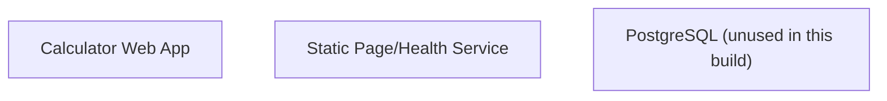
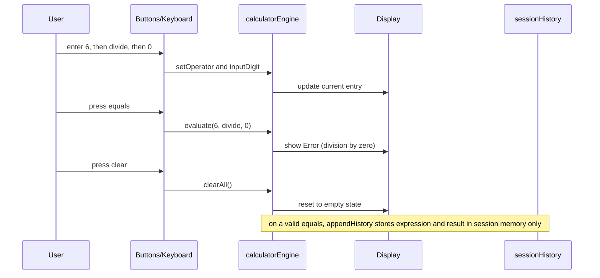
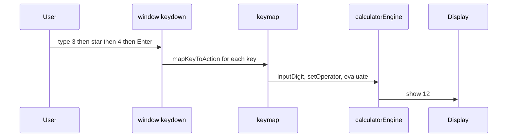
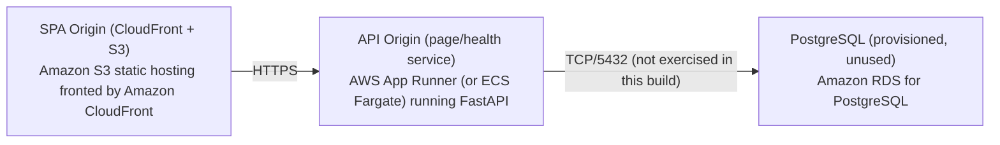

# Architecture

> Maintained by QuorQ AI SDLC. Text between `sdlc:auto` markers is regenerated; anything outside them is yours and is kept.

<!-- sdlc:auto:start narrative -->
## Overview

### ARCH-COMP-web_spa · approved · source: architecture:component:web_spa

Calculator Web App (React 19) is the sole place where computation happens: display, number pad, operator/equals/clear controls, keyboard handling, and in-session history, all rendered client-side.

Component: Calculator Web App, technology React 19. Responsibilities: render responsive single-page calculator UI (display, on-screen number pad, operator/equals/clear buttons); handle keyboard input; perform the four arithmetic operations; support decimal entry with a single-decimal-point guard per operand; indicate division-by-zero as an error; maintain a recent-calculation history that lives only in the browser session. All computation occurs in the browser -- nothing is sent to a server.

### ARCH-COMP-api · approved · source: architecture:component:api

Static Page/Health Service (FastAPI 0.115) exists only to serve the built calculator app and report health; it contains no business logic.

Component: Static Page/Health Service, technology FastAPI 0.115. Responsibilities: serve the built calculator SPA assets and expose a health endpoint. Rationale given: there is no business logic to run because all computation is client-side, there are no accounts, and there is no server-side storage.

### ARCH-COMP-db · approved · source: architecture:component:db

PostgreSQL 16 is provisioned as the platform default but holds no application data in this build since calculations and history are not persisted server-side.

Component: PostgreSQL (unused in this build), technology PostgreSQL 16. Provisioned as the platform default. No calculations or history are persisted server-side in the MVP, so this database holds no application data; it stands ready only if server-side storage is introduced later.

### ARCH-CP-1 · approved · source: architecture:critical_path:Perform a calculation and show the result

Describes the core calculation flow: user builds an expression via buttons or keyboard, presses equals, and the SPA computes and displays the result, handling decimal de-duplication and division-by-zero.

Critical path: Perform a calculation and show the result. User builds an expression via on-screen buttons or keyboard, presses equals, and the SPA computes the result in the browser. Decimal points are de-duplicated per operand. Dividing by zero yields an 'Error' indication that the clear control can reset. Completed calculations are appended to the in-session history.

### ARCH-CP-2 · approved · source: architecture:critical_path:Keyboard-driven entry

Keyboard events are mapped to the same engine actions as the on-screen buttons, so typing works identically to clicking, with immediate display updates.

Critical path: Keyboard-driven entry. Keyboard events map to the same engine actions as on-screen buttons: digits and '.', operators (+ - * /), Enter for equals, Escape/Delete for clear. Each keypress updates the display immediately, per NFR-005.

**Related:** NFR-005

### ARCH-EP-health · approved · source: architecture:endpoint:GET /health

A liveness/readiness probe exposed by the page-serving API, returning a simple status payload.

Endpoint: GET /health. Purpose: liveness/readiness probe for the page-serving service. Returns a simple status payload; performs no calculation and touches no data.

### ARCH-DEPLOY-spa · approved · source: architecture:deployment_node:SPA Origin (CloudFront + S3)

The calculator SPA is hosted as a static build on Amazon S3 fronted by CloudFront, serving the app globally from its own origin.

Deployment node: SPA Origin (page/health service). Infrastructure: Amazon S3 static hosting fronted by Amazon CloudFront. Artifact: static React 19 build (HTML/CSS/JS).

**Related:** ARCH-COMP-web_spa

### ARCH-DEPLOY-api · approved · source: architecture:deployment_node:API Origin (page/health service)

The page/health service runs as a containerized FastAPI app on AWS App Runner or ECS Fargate, served from a separate origin than the SPA.

Deployment node: API Origin (page/health service). Infrastructure: AWS App Runner (or ECS Fargate) running a FastAPI container. Stack: Python 3.12 / FastAPI 0.115 / Uvicorn.

**Related:** ARCH-COMP-api, ARCH-EP-health

### ARCH-DEPLOY-db · approved · source: architecture:deployment_node:PostgreSQL (provisioned, unused)

PostgreSQL 16 is provisioned via Amazon RDS as the platform default database, currently unused by the application.

Deployment node: PostgreSQL (provisioned, unused). Infrastructure: Amazon RDS for PostgreSQL. Version: PostgreSQL 16. Status: provisioned per platform default, not used for storage in this build.

**Related:** ARCH-COMP-db

### ARCH-TECH-frontend · approved · source: architecture:technology_decision:Frontend

React 19 was chosen for the frontend over Vue and Svelte to keep the single interactive page's state (number pad, operators, keyboard input, display, history) cleanly in sync.

Decision: Frontend = React 19. Alternatives considered: Vue, Svelte. Rationale: the entire product is one interactive page -- number pad, operators, keyboard input, live display and in-session history -- which React 19 keeps in sync cleanly with component state and a small arithmetic module; it also makes the responsive desktop/mobile layout straightforward.

**Related:** ARCH-COMP-web_spa

### ARCH-TECH-backend · approved · source: architecture:technology_decision:Backend

FastAPI 0.115 was chosen as the platform-default backend to serve the page and a health check, since there is no business logic to run.

Decision: Backend = FastAPI 0.115. Alternatives considered: Flask, static-only hosting with no backend. Rationale: with all computation client-side and no accounts or storage, the backend only serves the page and a health check; FastAPI 0.115 does this reliably as the platform default with essentially no custom code.

**Related:** ARCH-COMP-api

### ARCH-TECH-database · approved · source: architecture:technology_decision:Database

PostgreSQL 16 was named as the platform default database, though no schema is defined and the instance stays idle since there is no server-side storage.

Decision: Database = PostgreSQL 16. Alternatives considered: no database, SQLite. Rationale: named as the platform default; there is no server-side storage of calculations, and history is browser-session only, so no schema is defined and the instance stays idle in this build.

**Related:** ARCH-COMP-db

### ARCH-TECH-cloud · approved · source: architecture:technology_decision:Cloud

AWS was chosen as the platform default cloud provider over Netlify and Cloudflare Pages, hosting the SPA cheaply and serving it globally via CloudFront.

Decision: Cloud = AWS. Alternatives considered: Netlify, Cloudflare Pages. Rationale: AWS hosts the responsive single page cheaply and serves it globally via CloudFront to anonymous visitors on desktop and mobile, satisfying compatibility and immediate-use needs; it is the platform default.

**Related:** ARCH-DEPLOY-spa, ARCH-DEPLOY-api, ARCH-DEPLOY-db
<!-- sdlc:auto:end narrative -->

<!-- sdlc:auto:start building-blocks -->
## Building Block View

| ID | Name | Technology | Responsibility | Depends on |
|---|---|---|---|---|
| web_spa | Calculator Web App | React 19 | Renders the responsive single-page calculator: display, on-screen number pad, operator/equals/clear buttons, keyboard input handling, the four arithmetic operations, decimal entry with single-decimal-point guard, division-by-zero error indication, and in-session recent-calculation history. All computation happens here in the browser; nothing is sent to a server. | — |
| api | Static Page/Health Service | FastAPI 0.115 | Serves the built calculator app and exposes a health endpoint. There is no business logic to run because all computation is client-side with no accounts and no server-side storage. | — |
| db | PostgreSQL (unused in this build) | PostgreSQL 16 | Provisioned as the platform default. No calculations or history are persisted server-side, so this database holds no application data in the MVP; it stands ready only if server-side storage is introduced later. | — |

<!-- sdlc:auto:end building-blocks -->

<!-- sdlc:auto:start runtime -->
## Runtime View

### Perform a calculation and show the result

User builds an expression via on-screen buttons or keyboard, presses equals, and the SPA computes the result in the browser. Decimal points are de-duplicated per operand; dividing by zero yields an 'Error' indication that clear can reset. Completed calculations are appended to the in-session history.

- **Components:** web_spa
- **Modules:** calculatorEngine, displayState, inputHandlers, sessionHistory
- **Key functions:** inputDigit(digit), inputDecimal(), setOperator(op), evaluate(a, op, b), formatResult(value), appendHistory(expression, result), clearAll()

### Keyboard-driven entry

Keyboard events map to the same engine actions as on-screen buttons: digits and '.', operators (+ - * /), Enter for equals, Escape/Delete for clear. Each keypress updates the display immediately (NFR-005).

- **Components:** web_spa
- **Modules:** inputHandlers, keymap, calculatorEngine, displayState
- **Key functions:** onKeyDown(event), mapKeyToAction(key), dispatchAction(action)

<!-- sdlc:auto:end runtime -->

<!-- sdlc:auto:start deployment-view -->
## Deployment View

| Name | Service | Runtime | Scaling | Environment |
|---|---|---|---|---|
| SPA Origin (CloudFront + S3) | Amazon S3 static hosting fronted by Amazon CloudFront | Static React 19 build (HTML/CSS/JS) | CDN edge caching, serverless static delivery | dev |
| API Origin (page/health service) | AWS App Runner (or ECS Fargate) running FastAPI | Python 3.12 / FastAPI 0.115 / Uvicorn container | Single small instance; scale-to-low for a health-only service | dev |
| PostgreSQL (provisioned, unused) | Amazon RDS for PostgreSQL | PostgreSQL 16 | Smallest single instance; idle in this build | dev |

| Source | Target | Protocol |
|---|---|---|
| SPA Origin (CloudFront + S3) | API Origin (page/health service) | HTTPS |
| API Origin (page/health service) | PostgreSQL (provisioned, unused) | TCP/5432 (not exercised in this build) |

<!-- sdlc:auto:end deployment-view -->

<!-- sdlc:auto:start decisions -->
## Architecture Decisions

| Layer | Choice | ADR |
|---|---|---|
| Frontend | React 19 | [ADR-0001](adr/frontend.md) |
| Backend | FastAPI 0.115 | [ADR-0002](adr/backend.md) |
| Database | PostgreSQL 16 | [ADR-0003](adr/database.md) |
| Cloud | AWS | [ADR-0004](adr/cloud.md) |
<!-- sdlc:auto:end decisions -->

<!-- sdlc:auto:start links -->
## Related Documents

- [Data Model](data-model.md)
- [API Specification](api/openapi.yaml)
- [Architecture Decision Records](adr/README.md)
<!-- sdlc:auto:end links -->
