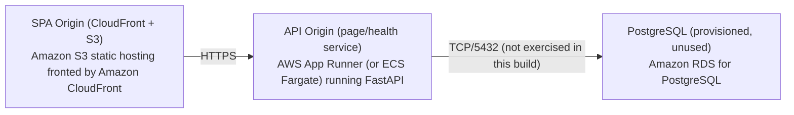

# Deployment Guide

> Maintained by QuorQ AI SDLC. Text between `sdlc:auto` markers is regenerated; anything outside them is yours and is kept.

<!-- sdlc:auto:start how-it-deploys -->
Pushes to `main` run `.github/workflows/deploy.yml`, which builds the API image (if there is a backend) and deploys the SPA to AWS Amplify. Commits touching only `docs/sdlc/**` don't deploy. Deployments can also be started from the platform's Deployment tab.
<!-- sdlc:auto:end how-it-deploys -->

<!-- sdlc:auto:start environments -->
| Name | Service | Runtime | Scaling | Environment |
|---|---|---|---|---|
| SPA Origin (CloudFront + S3) | Amazon S3 static hosting fronted by Amazon CloudFront | Static React 19 build (HTML/CSS/JS) | CDN edge caching, serverless static delivery | dev |
| API Origin (page/health service) | AWS App Runner (or ECS Fargate) running FastAPI | Python 3.12 / FastAPI 0.115 / Uvicorn container | Single small instance; scale-to-low for a health-only service | dev |
| PostgreSQL (provisioned, unused) | Amazon RDS for PostgreSQL | PostgreSQL 16 | Smallest single instance; idle in this build | dev |
<!-- sdlc:auto:end environments -->

<!-- sdlc:auto:start live -->
_Not deployed yet._
<!-- sdlc:auto:end live -->

<!-- sdlc:auto:start topology -->

<!-- sdlc:auto:end topology -->
